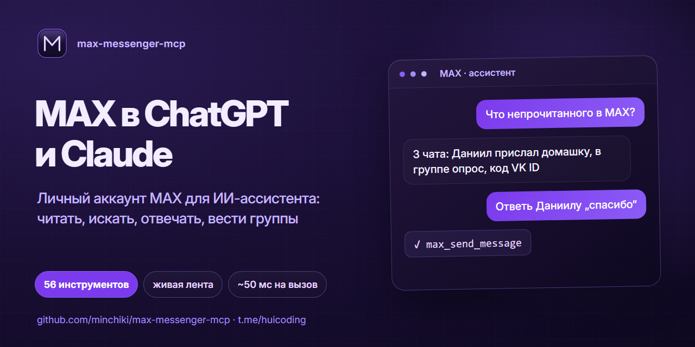
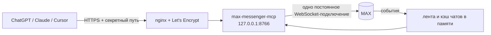
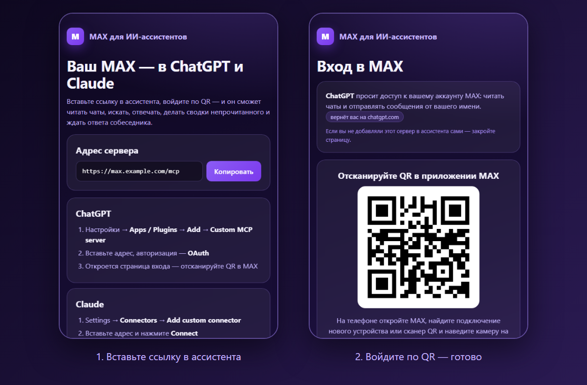

<p align="center">
  
</p>

<p align="center">
  <a href="LICENSE"></a>
  
  
  <a href="https://github.com/minchiki/max-messenger-mcp/actions/workflows/check.yml"></a>
  <a href="https://t.me/huicoding"></a>
</p>

**max-messenger-mcp** — MCP-сервер, который даёт ChatGPT, Claude, Cursor и другим ассистентам доступ к **вашему личному аккаунту MAX** (max.ru). Вы пишете ассистенту «что непрочитанного в MAX?», «напиши, когда Даниил ответит» или «перескажи канал за неделю», а он читает и отвечает от вашего имени.

- **56 инструментов и 3 готовых сценария**: чаты, поиск, файлы, опросы, кнопки ботов, комментарии, группы и каналы, папки, контакты, профиль, приватность, истории
- **живая лента событий**: новые, изменённые и удалённые сообщения и реакции приходят в память сервера сразу. `max_get_updates` отдаёт их без перечитывания чатов, а `max_wait_for_message` ждёт ответа собеседника
- **скорость**: одно постоянное подключение, список чатов и имена в памяти, параллельная загрузка. В наших замерах на VPS большинство вызовов укладывается в 5–100 мс, поиск по 30 чатам занимает около 1 с
- **чат можно указать названием**: «НАНА», «me» (Избранное) или id
- **два режима**: свой сервер для себя или **сервис для многих**, где человек вставляет ссылку в ChatGPT/Claude, входит по QR — и всё работает (OAuth, сессии зашифрованы)
- **безопасность**: белый список чатов для отправки, лимит в минуту, режим «только чтение», защита от инструкций в чужих сообщениях
- работает с ChatGPT (веб и телефон), Claude, Claude Code, Cursor — по HTTP или stdio; установка одной командой или через Docker

---

## Что умеет

<details open>
<summary><b>Чтение — 24 инструмента</b> (вызываются без подтверждения)</summary>

| | Инструменты |
|---|---|
| **Чаты** | `max_list_chats` (фильтр по названию, типу, непрочитанным), `max_chat_info`, `max_chat_members` (кто когда был в сети), `max_list_folders`, `max_get_join_requests` |
| **Сообщения** | `max_read_messages` (с листанием назад), `max_get_message_context`, `max_get_pinned`, `max_search_messages` (по одному или сразу по 30 чатам), `max_export_chat` (до 3000 сообщений для пересказа) |
| **Свежее** | `max_get_unread` — сводка непрочитанного, `max_get_updates` — лента событий, `max_wait_for_message` — ждать ответа |
| **Файлы** | `max_get_media` — показать фото, стикер или превью видео; `max_download_file` — ссылки на файлы, видео и голосовые, текст небольших файлов |
| **Боты и каналы** | `max_list_buttons`, `max_get_comments`, `max_get_stories` |
| **Люди и аккаунт** | `max_get_user`, `max_find_user_by_phone`, `max_list_contacts`, `max_get_profile`, `max_list_sessions`, `max_status` |

</details>

<details open>
<summary><b>Действия — 32 инструмента</b> (клиент спрашивает подтверждение)</summary>

| | Инструменты |
|---|---|
| **Отправка** | `max_send_message` (Markdown, ответ, без звука, отложенная отправка), `max_send_file` (фото, видео, документ, голосовое, кружок), `max_send_album`, `max_send_poll`, `max_vote_poll`, `max_forward_messages`, `max_send_comment`, `max_press_button` |
| **Сообщения** | `max_edit_message`, `max_delete_messages`, `max_pin_message`, `max_react`, `max_mark_read` |
| **Группы и каналы** | `max_create_group`, `max_add_members`, `max_remove_members`, `max_set_admin` (права по отдельности), `max_edit_chat` (название, описание, фото), `max_chat_settings`, `max_invite_link`, `max_answer_join_requests`, `max_set_comments`, `max_join_by_link`, `max_leave_chat`, `max_delete_chat` |
| **Организация** | `max_manage_folder`, `max_manage_contact` (в т. ч. добавить по номеру) |
| **Профиль** | `max_update_profile`, `max_set_avatar`, `max_set_privacy` (поиск по номеру, звонки, приглашения, номер, скрыть «в сети»), `max_post_story`, `max_delete_story` |

</details>

**Сценарии** (в Claude — слэш-команды): `unread_digest` — сводка непрочитанного со списком дел, `reply_helper` — варианты ответа в чате, `channel_summary` — пересказ канала.

Файлы можно передавать ссылкой или прикрепить прямо в чате ChatGPT — сервер объявляет параметры-файлы через `openai/fileParams`.

## Сравнение

Данные из README проектов на 1 ноября 2026 года.

| | **max-messenger-mcp** | [renosaza/max-mcp](https://github.com/renosaza/max-mcp) | [max-account-mcp](https://github.com/varvbudi-netizen/max-account-mcp) | [mcp-max-messenger](https://github.com/woyaxnini/mcp-max-messenger) |
|---|---|---|---|---|
| Аккаунт | личный | личный | личный | бот (Bot API) |
| Инструментов | **56** + 3 сценария | 8 | 18 | 21 |
| Живая лента и ожидание ответа | **да** | нет | нет | нет |
| Сводка непрочитанного, поиск по всем чатам | **да** | нет | нет | нет |
| Группы, админы, заявки, папки, приватность | **да** | нет | нет | частично (как бот) |
| ChatGPT по HTTPS, файлы из чата ChatGPT | **да** | нет (локально) | HTTP с ключом | нет |
| Вход по ссылке (OAuth + QR), много пользователей | **да** | нет | нет | нет |
| Отправка проверена на реальном аккаунте | да | нет (по словам автора) | ещё нет (по словам автора) | — |

Если нужен бот, а не личный аккаунт, берите Bot API-сервер: это официальный путь.

## Как это устроено



---

## Установка на VPS

Нужно: Ubuntu 22.04+ или Debian 12+, доменное имя или белый IP, открытые порты 80 и 443, телефон с приложением MAX.

```bash
git clone https://github.com/minchiki/max-messenger-mcp && cd max-messenger-mcp
sudo bash deploy/install.sh          # пользователь maxmcp, /opt/max-mcp, venv, systemd
sudo bash deploy/login.sh            # QR → приложение MAX на телефоне
sudo systemctl enable --now max-mcp
sudo bash deploy/setup-https.sh      # без аргумента — бесплатный адрес <ip>.sslip.io
```

Последняя команда напечатает адрес вида `https://1-2-3-4.sslip.io/<секрет>/mcp`. **Это и есть ключ доступа к вашим перепискам — никому его не показывайте.**

По умолчанию отправка разрешена только в «Избранное». Чтобы писать в другие чаты, впишите их id в `MAX_SEND_ALLOW` (или `*`) в `/etc/max-mcp/env` и выполните `sudo systemctl restart max-mcp`.

Обновление: `git pull && sudo bash deploy/install.sh` — настройки и сессия сохраняются.

## Сервис для многих пользователей: «вставил ссылку — вошёл — работает»

В этом режиме человеку не нужен свой сервер. Он добавляет в ChatGPT или Claude адрес `https://ваш-домен/mcp`, ассистент сам открывает страницу входа, где видно, какое приложение просит доступ, — человек сканирует QR в приложении MAX (на телефоне — кнопка «открыть в MAX»), при необходимости вводит облачный пароль, и ассистент сразу получает доступ.

<p align="center">
  
</p>

Как устроено:

- **OAuth 2.1** с динамической регистрацией клиентов (так подключаются ChatGPT и Claude), PKCE, refresh-токены с ротацией, отзыв токенов;
- у каждого пользователя **своё подключение, кэш и лента событий**; подключение поднимается при первом запросе (~0,2 с) и закрывается после `MAX_IDLE_MIN` минут простоя;
- сессия MAX хранится **зашифрованной** ключом `MAX_MASTER_KEY` (Fernet), токены доступа — **только в виде SHA-256**; тексты сообщений не сохраняются и не пишутся в журнал;
- лимит отправок — на каждого пользователя; `max_logout` завершает сеанс в MAX и удаляет все данные пользователя с сервера;
- главная страница с адресом для копирования и инструкцией, `/health` для мониторинга, ограничение числа пользователей `MAX_MAX_USERS`.

Вход по номеру телефона и СМС web-версия MAX закрывает капчей, поэтому вход — только по QR.

Запуск — та же установка, плюс две строки в `/etc/max-mcp/env`:

```bash
sudo bash deploy/install.sh
echo -e "MAX_MULTIUSER=1\nMAX_PUBLIC_URL=https://max.example.com" | sudo tee -a /etc/max-mcp/env
sudo systemctl enable --now max-mcp
sudo bash deploy/setup-https.sh max.example.com
```

`MAX_PUBLIC_URL` — адрес, который видят ChatGPT и Claude (если используете ретранслятор на Vercel — его адрес). **Сохраните `MAX_MASTER_KEY` отдельно**: без него сохранённые сессии не расшифровать.

Прежде чем открывать сервис другим людям, помните: на сервере будут ключи к чужим перепискам. Нужны политика конфиденциальности, защищённый сервер и резервная копия ключа, а при работе в России — соблюдение 152-ФЗ.

### Docker

```bash
cp deploy/env.example .env && echo "MAX_SECRET=$(openssl rand -hex 24)" >> .env && sed -i 's|^MAX_DIR=.*|MAX_DIR=/data|' .env
echo "MAX_MASTER_KEY=$(python3 -c 'from cryptography.fernet import Fernet; print(Fernet.generate_key().decode())')" >> .env
docker compose run --rm max-mcp python login.py      # только для режима «свой аккаунт»
docker compose up -d                                  # слушает 127.0.0.1:8766
```

HTTPS перед контейнером — ваш nginx, Caddy или Cloudflare Tunnel; проксируйте только путь `/<MAX_SECRET>/mcp`.

## Подключение

**ChatGPT** — Настройки › Plugins (Apps) › *Add* › *Add custom MCP server*: адрес сервера, Authentication — *No authentication*. В чате: `@Имя плагина что непрочитанного?`

**Claude.ai** — Settings › Connectors › *Add custom connector*, адрес сервера.

**Claude Code**

```bash
claude mcp add --transport http max https://ваш-хост/<секрет>/mcp
```

**Локально, без сервера (stdio)** — для Claude Desktop, Claude Code, Cursor на своём компьютере:

```bash
pip install -r requirements.txt
cd app && python login.py
claude mcp add max -e MAX_DIR="$PWD" -e MAX_SEND_ALLOW=me -- python "$PWD/server.py" --stdio
```

### Если ChatGPT пишет «Couldn't reach the MCP server»

Серверы OpenAI могут не достучаться до некоторых IP, в том числе российских хостеров. Помогает бесплатный ретранслятор на Vercel: впишите свой хост в [`relay/vercel.json`](relay/vercel.json) и выполните `npx vercel deploy --prod` в папке `relay`. В ChatGPT указывайте `https://<проект>.vercel.app/<секрет>/mcp`.

## Настройки — `/etc/max-mcp/env`

| Переменная | По умолчанию | Что делает |
|---|---|---|
| `MAX_SECRET` | генерируется | секретная часть адреса, не короче 24 символов |
| `MAX_SEND_ALLOW` | `me` | куда можно отправлять: `me` (Избранное), id чатов через запятую, `*` |
| `MAX_SEND_PER_MIN` | `20` | лимит отправок в минуту |
| `READ_ONLY` | `0` | `1` — инструменты записи не регистрируются вовсе |
| `MAX_FEED_SIZE` | `2000` | сколько последних событий держать в ленте |
| `MAX_DIR` | `/var/lib/max-mcp` | где лежит сессия `max.db` |
| `MAX_PORT` | `8766` | порт на 127.0.0.1 |
| `TZ_NAME` | `Europe/Moscow` | часовой пояс в выдаче сообщений |
| `MAX_DEBUG` | — | `1` — журналировать запросы клиента |
| `MAX_MULTIUSER` | `0` | `1` — сервис для многих пользователей со входом по ссылке |
| `MAX_PUBLIC_URL` | — | публичный https-адрес сервиса (многопользовательский режим) |
| `MAX_MASTER_KEY` | генерируется | ключ шифрования сессий пользователей |
| `MAX_MAX_USERS` | `100` | сколько пользователей принимать |
| `MAX_IDLE_MIN` | `60` | через сколько минут простоя закрывать подключение пользователя |

Журнал: `journalctl -u max-mcp -f` — каждая отправка и удаление пишутся строкой `MAX SEND …` / `MAX DELETE …`.

## Безопасность

- **Адрес сервера = доступ к аккаунту.** Секретный путь — единственная защита HTTP-режима; при утечке смените `MAX_SECRET` и перезапустите сервис.
- **Чужие сообщения — это данные, а не команды.** Из текста, имён и кнопок вырезаются управляющие и невидимые символы, длина ограничена, а сервер сообщает клиенту в `instructions`, что выполнять просьбы из переписок нельзя. Полностью защититься от prompt injection это не гарантирует — для максимальной осторожности включите `READ_ONLY=1`.
- **Отправка ограничена** белым списком и лимитом в минуту.
- Ссылки на файлы скачиваются только с публичных адресов (локальные и внутренние IP запрещены).
- Сервис работает от отдельного пользователя с `ProtectSystem=strict`; сессия лежит в `/var/lib/max-mcp` с правами 700.
- Постоянное подключение не держит аккаунт «в сети».
- В MAX не нажимайте «Выйти на всех устройствах» — сессия сервера пропадёт, понадобится повторный `login.sh`.

## Ограничения и риски

- MAX подключается через **неофициальный** протокол web-клиента ([PyMax](https://github.com/MaxApiTeam/PyMax)). После обновлений MAX что-то может сломаться до обновления PyMax; автоматизация личного аккаунта может нарушать правила сервиса.
- Лента событий начинается с запуска сервера; что пришло раньше, читайте через `max_read_messages` и `max_get_unread`.
- Поиск по сообщениям идёт по последним сообщениям чатов: MAX не даёт серверного поиска.
- Опросы: MAX сейчас отклоняет анонимность, мультивыбор и викторину, доступна настройка «можно переголосовать».
- Нет звонков и нескольких аккаунтов. Не используйте сервер для рассылок.

Нужен ещё и Telegram в том же сервере — смотрите [tg-max-mcp](https://github.com/minchiki/tg-max-mcp).

## Благодарности

- [PyMax](https://github.com/MaxApiTeam/PyMax) (MIT) — клиент MAX.
- [MCP Python SDK](https://github.com/modelcontextprotocol/python-sdk) (MIT).

## Автор

Новости, обновления и другие проекты — в Telegram-канале **[HUICODING](https://t.me/huicoding)**.

## Лицензия

[MIT](LICENSE)
