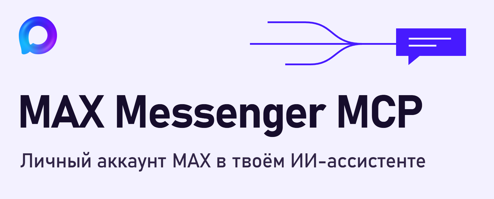
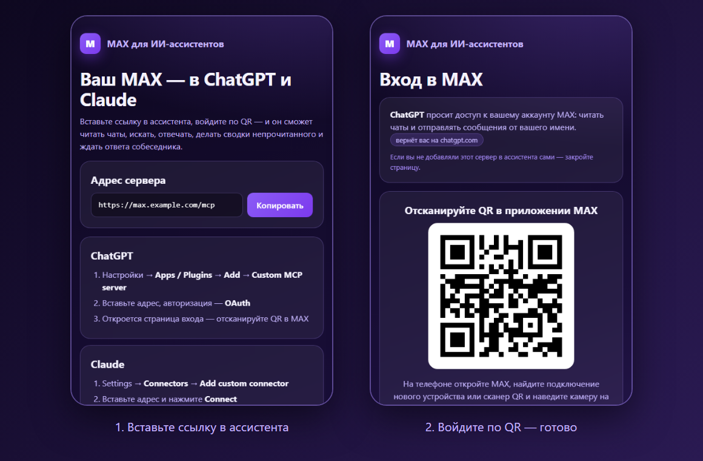
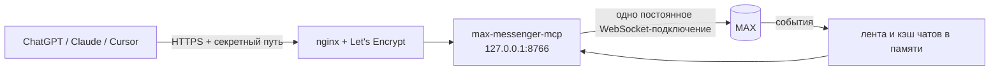

> Найди в MAX, какие правки просили внести в баннер на прошлой неделе.

**Пример ответа · данные вымышлены.** В чате «Фестиваль» попросили увеличить дату и заменить фото сцены. Последняя правка от пятницы — оставить светлый фон.

**[Быстрый старт](#start)** · [Все инструменты](#tools)

MAX Messenger MCP — независимый проект сообщества. Он подключает личный аккаунт MAX к ChatGPT, Claude или другому MCP-клиенту. После подключения задавайте вопросы обычными словами.

## Что можно поручить ассистенту

| Задача | Что попросить |
|---|---|
| Найти решение в переписке | «Найди сообщения про смету в чате „Фестиваль“ за октябрь». Название чата и период сужают поиск. |
| Разобрать непрочитанное | «Собери непрочитанное и выдели вопросы, где ждут моего ответа». |
| Дождаться ответа | «Подожди следующее сообщение в чате „Макеты“». Ассистент ждёт во время запроса, пока подключение активно. |

<a id="start"></a>

## Быстрый старт

**Есть ссылка от оператора сервиса?** Добавьте URL вида `https://ваш-домен/mcp` в настройки MCP-клиента, выберите OAuth и откройте страницу входа. До сканирования QR учтите: сервер получит сессию вашего личного аккаунта. В этом режиме она хранится у оператора в зашифрованном виде в `service.db`. Если вам нужен доступ только для чтения, уточните у оператора, включён ли на сервере `READ_ONLY=1`. После входа спросите «Что непрочитанного в MAX?».

**Разворачиваете сами?** Выберите способ:

- [На компьютере через stdio](#local) — для клиента, который умеет запускать локальные процессы.
- [На VPS через HTTPS](#vps) или [в Docker](#docker) — для доступа к своему аккаунту по секретному адресу.
- [Сервис с OAuth](#multi) — если у каждого пользователя должен быть свой вход по QR.

В личном режиме сессия хранится в `MAX_DIR/max.db`: при установке через systemd это `/var/lib/max-mcp/max.db`, в Docker — `./data/max.db` на хосте, в локальном примере ниже — каталог `app`. Владелец сессии получает доступ к переписке. Чтобы оставить только чтение, **до входа** задайте `READ_ONLY=1` в окружении процесса, в `/etc/max-mcp/env` для systemd или в `.env` для Docker.

<a id="local"></a>

## На компьютере через stdio

Команды для Bash и Claude Code. Понадобятся Git, Python с venv и приложение MAX на телефоне.

```bash
git clone https://github.com/minchiki/max-messenger-mcp
cd max-messenger-mcp
python3 -m venv .venv
source .venv/bin/activate
python -m pip install -r requirements.txt
cd app
python login.py
claude mcp add max -e MAX_DIR="$PWD" -e READ_ONLY=1 -- "$VIRTUAL_ENV/bin/python" "$PWD/server.py" --stdio
```

В Cursor или Claude Desktop укажите тот же абсолютный путь к Python как команду, путь к `server.py` и `--stdio` как аргументы, а `MAX_DIR` и `READ_ONLY` как переменные окружения. Для отправки в «Избранное» замените `READ_ONLY=1` на `READ_ONLY=0` и задайте `MAX_SEND_ALLOW=me`.

<a id="vps"></a>

## Установка на VPS

Нужно: Ubuntu 22.04+ или Debian 12+, доменное имя или белый IP, открытые порты 80 и 443, телефон с приложением MAX.

```bash
git clone https://github.com/minchiki/max-messenger-mcp && cd max-messenger-mcp
sudo bash deploy/install.sh          # пользователь maxmcp, /opt/max-mcp, venv, systemd
sudoedit /etc/max-mcp/env            # для чтения задайте READ_ONLY=1
sudo bash deploy/login.sh            # QR → приложение MAX на телефоне
sudo systemctl enable --now max-mcp
sudo bash deploy/setup-https.sh      # без аргумента — бесплатный адрес <ip>.sslip.io
```

Последняя команда напечатает адрес вида `https://1-2-3-4.sslip.io/<секрет>/mcp`. **Это и есть ключ доступа к вашим перепискам — никому его не показывайте.**

По умолчанию отправка разрешена только в «Избранное». Чтобы писать в другие чаты, впишите их id в `MAX_SEND_ALLOW` (или `*`) в `/etc/max-mcp/env` и выполните `sudo systemctl restart max-mcp`.

Обновление: `git pull && sudo bash deploy/install.sh` — настройки и сессия сохраняются.

<a id="multi"></a>

## Сервис для многих пользователей: «вставил ссылку — вошёл — работает»

В этом режиме человеку не нужен свой сервер. Он добавляет в ChatGPT или Claude адрес `https://ваш-домен/mcp`, ассистент сам открывает страницу входа, где видно, какое приложение просит доступ, — человек сканирует QR в приложении MAX (на телефоне — кнопка «открыть в MAX»), при необходимости вводит облачный пароль, и ассистент сразу получает доступ.

<p align="center">
  
</p>

Как устроено:

- **OAuth 2.1** с динамической регистрацией клиентов (так подключаются ChatGPT и Claude), PKCE, refresh-токены с ротацией, отзыв токенов;
- у каждого пользователя **своё подключение, кэш и лента событий**; подключение поднимается при первом запросе и закрывается после `MAX_IDLE_MIN` минут простоя;
- сессия MAX хранится **зашифрованной** ключом `MAX_MASTER_KEY` (Fernet), токены доступа — **только в виде SHA-256**; тексты сообщений не сохраняются и не пишутся в журнал;
- лимит отправок — на каждого пользователя; `max_logout` завершает сеанс в MAX и удаляет все данные пользователя с сервера;
- главная страница с адресом для копирования и инструкцией, `/health` для мониторинга, ограничение числа пользователей `MAX_MAX_USERS`.

Вход по номеру телефона и СМС web-версия MAX закрывает капчей, поэтому вход — только по QR.

Запуск — та же установка, плюс две строки в `/etc/max-mcp/env`:

```bash
git clone https://github.com/minchiki/max-messenger-mcp && cd max-messenger-mcp
sudo bash deploy/install.sh
echo -e "MAX_MULTIUSER=1\nMAX_PUBLIC_URL=https://max.example.com" | sudo tee -a /etc/max-mcp/env
sudoedit /etc/max-mcp/env  # проверьте домен и READ_ONLY до запуска
sudo systemctl enable --now max-mcp
sudo systemctl restart max-mcp
sudo bash deploy/setup-https.sh max.example.com
```

`MAX_PUBLIC_URL` — адрес, который видят ChatGPT и Claude (если используете ретранслятор на Vercel — его адрес). **Сохраните `MAX_MASTER_KEY` отдельно**: без него сохранённые сессии не расшифровать.

Эксплуатация:

- **резервные копии**: `sudo bash deploy/backup.sh` (согласованная копия базы, хранится 14 штук; для ежедневного запуска — строка cron в начале скрипта). Ключ `MAX_MASTER_KEY` храните отдельно от копий;
- **мониторинг**: `GET /health` → `{"ok": true, "online": N}`;
- **лимиты**: `setup-https.sh` включает в nginx 30 запросов в минуту на вход и регистрацию и 600 — на остальное с одного IP;
- **страница конфиденциальности** `/privacy`: что хранится, как удалить данные, контакт оператора (`MAX_OPERATOR_CONTACT`);
- модель угроз и как сообщить об уязвимости — в [SECURITY.md](SECURITY.md).

Прежде чем открывать сервис другим людям, помните: на сервере будут ключи к чужим перепискам. Нужны политика конфиденциальности, защищённый сервер и резервная копия ключа, а при работе в России — соблюдение 152-ФЗ.

<a id="docker"></a>

## Docker

Выполняйте из корня клонированного репозитория в Bash на Linux. На хосте нужны Docker Compose и OpenSSL.

```bash
cp deploy/env.example .env && echo "MAX_SECRET=$(openssl rand -hex 24)" >> .env && sed -i 's|^MAX_DIR=.*|MAX_DIR=/data|' .env
echo "MAX_MASTER_KEY=$(openssl rand -base64 32 | tr '/+' '_-')" >> .env
sudo install -d -m 700 -o 10001 -g 10001 data
# Для доступа только на чтение укажите READ_ONLY=1 в .env до запуска.
docker compose run --rm max-mcp python login.py      # только для режима «свой аккаунт»
docker compose up -d                                  # слушает 127.0.0.1:8766
```

HTTPS перед контейнером — для личного режима ваш nginx, Caddy или Cloudflare Tunnel; проксируйте только путь `/<MAX_SECRET>/mcp`.

## Подключение

**ChatGPT** — Настройки › Plugins (Apps) › *Add* › *Add custom MCP server*: адрес сервера, для личного секретного URL — *No authentication*, для сервиса со входом по QR — *OAuth*. В чате: `@Имя плагина что непрочитанного?`

**Claude.ai** — Settings › Connectors › *Add custom connector*, адрес сервера.

**Claude Code**

```bash
claude mcp add --transport http max 'https://ваш-хост/<секрет>/mcp'
```

### Если ChatGPT пишет «Couldn't reach the MCP server»

Серверы OpenAI могут не достучаться до некоторых IP, в том числе российских хостеров. Помогает бесплатный ретранслятор на Vercel: впишите свой хост в [`relay/vercel.json`](relay/vercel.json) и выполните `npx vercel deploy --prod` в папке `relay`. В ChatGPT указывайте `https://<проект>.vercel.app/<секрет>/mcp`.

<a id="tools"></a>

## Справочник инструментов

<details>
<summary><b>Чтение — 26 инструментов</b> (вызываются без подтверждения)</summary>

| | Инструменты |
|---|---|
| **Чаты** | `max_list_chats` (фильтр по названию, типу, непрочитанным), `max_chat_info`, `max_chat_members` (кто когда был в сети), `max_list_folders`, `max_get_join_requests` |
| **Сообщения и история** | `max_read_messages` (любой период и глубина до 5000 сообщений за вызов), `max_messages_around_date` — «прыгнуть» к дате, `max_chat_timeline` — активность по месяцам и самые активные участники, `max_get_message_context`, `max_get_pinned`, `max_search_messages` (до 20 000 сообщений в чате или сразу по 30 чатам, за период), `max_export_chat` (до 5000 сообщений для пересказа) |
| **Свежее** | `max_get_unread` — сводка непрочитанного, `max_get_updates` — лента событий, `max_wait_for_message` — ждать ответа |
| **Файлы** | `max_get_media` — показать фото, стикер или превью видео; `max_download_file` — ссылки на файлы, видео и голосовые, текст небольших файлов |
| **Боты и каналы** | `max_list_buttons`, `max_get_comments`, `max_get_stories` |
| **Люди и аккаунт** | `max_get_user`, `max_find_user_by_phone`, `max_list_contacts`, `max_get_profile`, `max_list_sessions`, `max_status` |

</details>

<details>
<summary><b>Действия — 32 инструмента</b> (подтверждение зависит от клиента)</summary>

| | Инструменты |
|---|---|
| **Отправка** | `max_send_message` (Markdown, ответ, без звука, отложенная отправка), `max_send_file` (фото, видео, документ, голосовое, кружок), `max_send_album`, `max_send_poll`, `max_vote_poll`, `max_forward_messages`, `max_send_comment`, `max_press_button` |
| **Сообщения** | `max_edit_message`, `max_delete_messages`, `max_pin_message`, `max_react`, `max_mark_read` |
| **Группы и каналы** | `max_create_group`, `max_add_members`, `max_remove_members`, `max_set_admin` (права по отдельности), `max_edit_chat` (название, описание, фото), `max_chat_settings`, `max_invite_link`, `max_answer_join_requests`, `max_set_comments`, `max_join_by_link`, `max_leave_chat`, `max_delete_chat` |
| **Организация** | `max_manage_folder`, `max_manage_contact` (в т. ч. добавить по номеру) |
| **Профиль** | `max_update_profile`, `max_set_avatar`, `max_set_privacy` (поиск по номеру, звонки, приглашения, номер, скрыть «в сети»), `max_post_story`, `max_delete_story` |

</details>

**Сценарии** (в Claude — слэш-команды): `unread_digest` — сводка непрочитанного со списком дел, `reply_helper` — варианты ответа в чате, `channel_summary` — пересказ канала.

### История за любой период

Просите словами, ассистент сам подставит даты:

- «покажи переписку с Даниилом за март 2025» → `max_read_messages(chat="Даниил", date_from="2025-03", date_to="2025-03", limit=5000)`
- «что мне писали год назад» → `max_messages_around_date(chat="Даниил", when="год назад")`
- «когда мы больше всего общались» → `max_chat_timeline`, затем чтение нужного месяца
- «найди, где обсуждали договор, весной» → `max_search_messages(query="договор", date_from="2026-03", date_to="2026-05")`

Даты понимаются в форматах `2025-11-01`, `2025-11-01 14:30`, `31.10.2025`, `2025-03` (месяц), `2025` (год), `1y`, `6m`, `30d`, «год назад», «полгода назад». За один вызов — до 5000 сообщений и около 80 000 символов; если ответ обрезан, в конце будет подсказка `before_id`, с которой чтение продолжается дальше в прошлое.

Файлы можно передавать ссылкой или прикрепить прямо в чате ChatGPT — сервер объявляет параметры-файлы через `openai/fileParams`.

## Как это устроено



## Другие реализации

[renosaza/max-mcp](https://github.com/renosaza/max-mcp) · [max-account-mcp](https://github.com/varvbudi-netizen/max-account-mcp) · [mcp-max-messenger](https://github.com/woyaxnini/mcp-max-messenger)

## Настройки — `/etc/max-mcp/env`

| Переменная | По умолчанию | Что делает |
|---|---|---|
| `MAX_SECRET` | генерируется | секретная часть адреса, не короче 24 символов |
| `MAX_SEND_ALLOW` | `me` для личного режима, `*` для сервиса | куда можно отправлять: `me` (Избранное), id чатов через запятую, `*` |
| `MAX_SEND_PER_MIN` | `20` | лимит отправок в минуту |
| `READ_ONLY` | `0` | `1` — инструменты записи не регистрируются вовсе |
| `MAX_FEED_SIZE` | `2000` | сколько последних событий держать в ленте |
| `MAX_DIR` | `/var/lib/max-mcp` | где лежит сессия `max.db` |
| `MAX_PORT` | `8766` | порт на 127.0.0.1 |
| `TZ_NAME` | `Europe/Moscow` | часовой пояс в выдаче сообщений |
| `MAX_DEBUG` | — | `1` — журналировать запросы клиента |
| `MAX_MULTIUSER` | `0` | `1` — сервис для многих пользователей со входом по ссылке |
| `MAX_PUBLIC_URL` | — | публичный https-адрес сервиса (многопользовательский режим) |
| `MAX_MASTER_KEY` | генерируется | ключ шифрования сессий пользователей |
| `MAX_MAX_USERS` | `100` | сколько пользователей принимать |
| `MAX_IDLE_MIN` | `60` | через сколько минут простоя закрывать подключение пользователя |
| `MAX_REDIRECT_HOSTS` | `chatgpt.com,chat.openai.com,claude.ai,claude.com` | куда можно вернуть код авторизации (https); localhost разрешён всегда |
| `MAX_OPERATOR_CONTACT` | `https://t.me/huicoding` | контакт оператора на странице конфиденциальности |
| `MAX_REDIRECT_SCHEMES` | `cursor,vscode,vscode-insiders,windsurf` | схемы приложений для возврата кода |

Журнал: `journalctl -u max-mcp -f` — каждая отправка и удаление пишутся строкой `MAX SEND …` / `MAX DELETE …`.

## Безопасность

- **Адрес сервера = доступ к аккаунту.** В личном HTTP-режиме доступ открывает секретный путь; при утечке смените `MAX_SECRET` и перезапустите сервис.
- **Чужие сообщения — это данные, а не команды.** Из текста, имён и кнопок вырезаются управляющие и невидимые символы, длина ограничена, а сервер сообщает клиенту в `instructions`, что выполнять просьбы из переписок нельзя. Полностью защититься от prompt injection это не гарантирует — для максимальной осторожности включите `READ_ONLY=1`.
- **Отправка ограничена** белым списком и лимитом в минуту.
- Ссылки на файлы скачиваются только с публичных адресов: имя разрешается один раз, соединение идёт на проверенный IP (защита от DNS rebinding), размер ограничен при чтении потока.
- В многопользовательском режиме код авторизации возвращается только на разрешённые адреса (ChatGPT, Claude, localhost, схемы редакторов): чужой сайт не сможет выманить доступ ссылкой входа. Страницы отдаются с CSP и запретом встраивания во фрейм.
- Журнал запросов uvicorn выключен: секретный путь и id входа не попадают в логи.
- Сервис работает от отдельного пользователя с `ProtectSystem=strict`; сессия лежит в `/var/lib/max-mcp` с правами 700.
- Постоянное подключение не держит аккаунт «в сети».
- В MAX не нажимайте «Выйти на всех устройствах» — сессия сервера пропадёт, понадобится повторный `login.sh`.

## Ограничения и риски

- MAX подключается через **неофициальный** протокол web-клиента ([PyMax](https://github.com/MaxApiTeam/PyMax)). После обновлений MAX что-то может сломаться до обновления PyMax; автоматизация личного аккаунта может нарушать правила сервиса.
- Лента событий начинается с запуска сервера; что пришло раньше, читайте через `max_read_messages` и `max_get_unread`.
- Поиск по сообщениям идёт по последним сообщениям чатов: MAX не даёт серверного поиска.
- Опросы: MAX сейчас отклоняет анонимность, мультивыбор и викторину, доступна настройка «можно переголосовать».
- Звонки не поддерживаются. В личном режиме используется один аккаунт. Не используйте сервер для рассылок.

Нужен ещё и Telegram в том же сервере — смотрите [tg-max-mcp](https://github.com/minchiki/tg-max-mcp).

## Благодарности

- Знак MAX на обложке взят из [официального брендбука](https://go.max.ru/brandbook), [архив цветного знака](https://st.max.ru/brandbook/max-colored.zip). [Редактируемая обложка](assets/banner.svg).

- [PyMax](https://github.com/MaxApiTeam/PyMax) (MIT) — клиент MAX.
- [MCP Python SDK](https://github.com/modelcontextprotocol/python-sdk) (MIT).

## Автор

Новости, обновления и другие проекты — в Telegram-канале **[HUICODING](https://t.me/huicoding)**.

## Лицензия

[MIT](LICENSE) · [Проверки проекта](https://github.com/minchiki/max-messenger-mcp/actions/workflows/check.yml)
